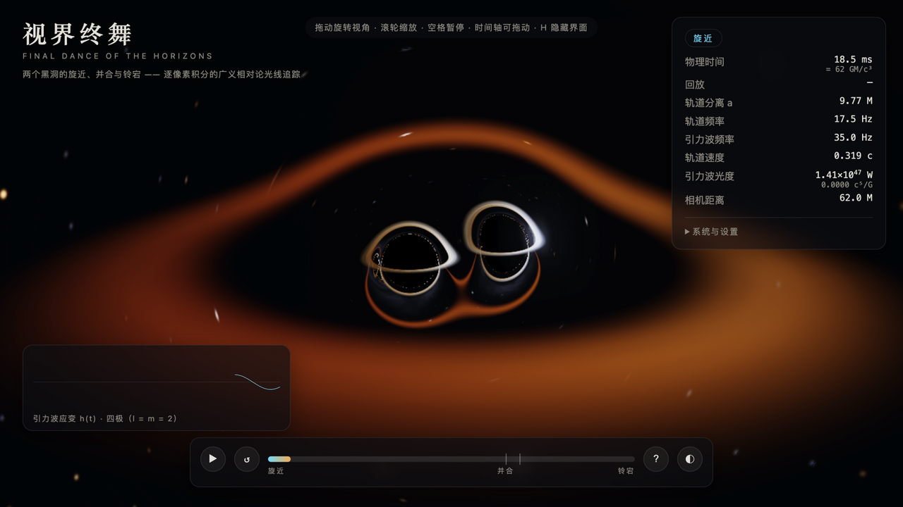
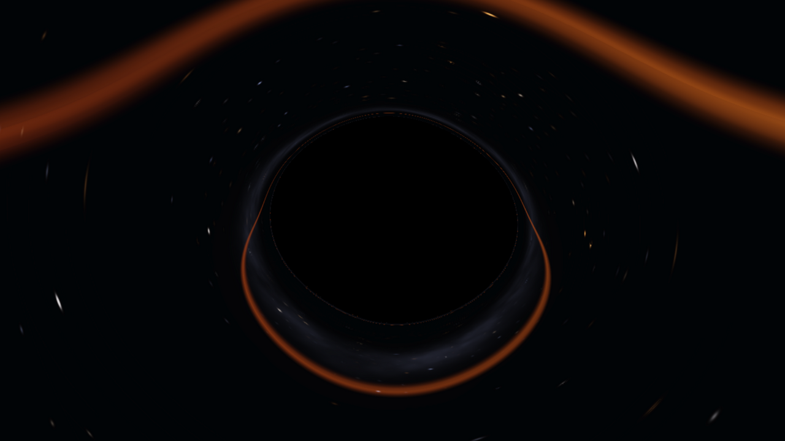
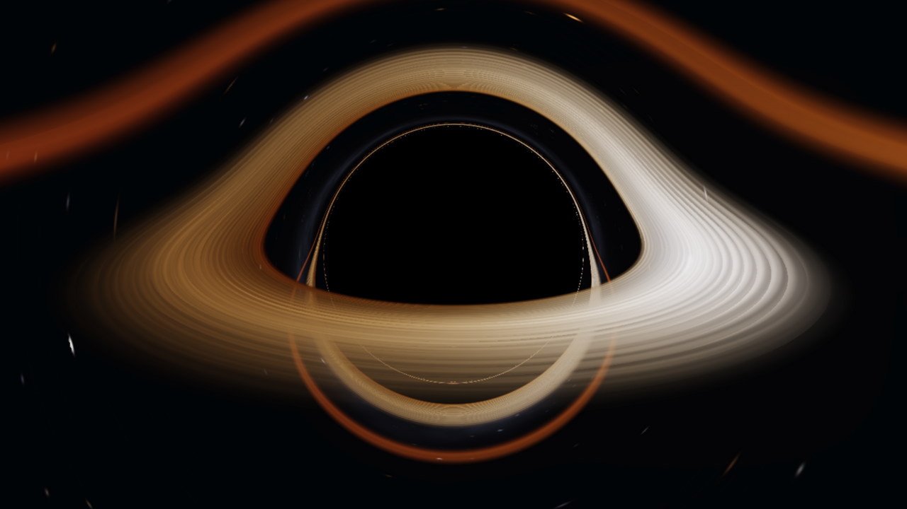

# 视界终舞 · Final Dance of the Horizons

两个黑洞从旋近、并合到铃宕的广义相对论模拟。画面中对每个像素在弯曲时空里积分一条光线，右侧的数字是这条轨道在真实物理下的时间、频率和光度。

| 旋近 | 并合 | 铃宕 |
|---|---|---|
|  |  |  |

## 观看

**方式一：不需要安装，也不需要联网。** 双击打开单文件即可，打开后自动循环播放：

- 仓库根目录的 `视界终舞.html`
- 或本项目中的 `dist/视界终舞.html`

Three.js、着色器和全部代码都内联在这一个文件里（约 550 KB）。

**方式二：开发版**（`index.html` 通过 importmap 从 CDN 加载 Three.js，需要联网）：

```bash
npm install          # three.js、esbuild
npm run dev          # → http://localhost:5173/
npm run build        # 把源码与 three.js 打包，生成 dist/视界终舞.html
npm test             # 物理单元测试
```

需要 Node.js 18 或更新版本。

### 操作

| 操作 | 效果 |
|---|---|
| 拖动 | 旋转视角（OrbitControls，带阻尼） |
| 滚轮 / 双指 | 缩放 |
| 空格 | 暂停 / 继续 |
| `R` | 从头播放 |
| `H` | 隐藏 / 显示界面 |
| 时间轴 | 点击或拖动跳转 |
| 右上“系统与设置” | 质量比 1 : 1 … 1 : 12、总质量、回放速度、画质、吸积盘、自动运镜 |

也可以用网址参数直接指定状态，例如 `视界终舞.html?q=4&M=150&t=24.5&paused=1&ui=0`：

| 参数 | 含义 |
|---|---|
| `q` | 质量比 |
| `M` | 总质量（太阳质量） |
| `t` | 从哪个屏幕时间（秒）开始 |
| `paused=1` | 暂停在该时刻 |
| `ui=0` | 不显示任何界面 |
| `cam=0` | 关闭自动运镜 |
| `disk=0` | 不显示吸积盘 |
| `quality=low\|medium\|high` | 固定画质 |
| `scale` | 固定内部分辨率倍率（调试用） |

## 物理模型

长度以总质量对应的几何长度 `GM/c²` 为单位（下文记作 M），时间以 `GM/c³` 为单位。画面的几何形状与总质量无关；总质量只用来把时间换算成秒、把频率换算成赫兹。

### 严格计算的部分

**光线。** 在 Schwarzschild 时空中对零测地线逐像素做四阶 Runge–Kutta 积分。所用的三维方程

```
x″ = −3 M h² (x − x_c) / r⁵ ,    h² = |(x − x_c) × x′|
```

与 Binet 方程 `u″ + u = 3Mu²` 等价，给出的是精确的光线轨迹。仿射参数以无穷远处 `|x′| = 1` 归一，所以 `x′` 正是归一化到 E = 1 的光子动量。弱场极限回到偏折角 `4GM/c²b`，阴影半径为 `3√3 GM/c²`。

**频移与增亮。** 盘物质发出的光，观测频率与发射频率之比

```
g = √(1 − 3M/r) ⁄ (1 − Ω·L)
```

同时包含引力红移、纵向多普勒和横向多普勒；观测色温 = 发射温度 × g。接近观测者的一侧因此更亮更蓝，远离的一侧更暗更红。黑洞自身的轨道运动再乘一个狭义相对论的多普勒因子。

**颜色。** 对普朗克黑体谱在 380–780 nm 上做数值积分，经 CIE 1931 标准观察者配色函数得到 XYZ，再变到线性 sRGB。所以盘的颜色是真实黑体在对应色温下的颜色。

**盘的运动。** 圆轨道角速度 `Ω = √(GM/r³)` 与最内稳定圆轨道 `r = 6GM/c²` 在 Schwarzschild 时空中是严格结果。温度按薄盘分布 `T ∝ [r⁻³(1 − √(r_in/r))]^¼`。

**铃宕。** 新黑洞是一个被激发的黑洞，按 l = m = 2、n = 0 的准正规模式振荡：`Mω = 0.373672 − 0.088963 i`。画面里视界与光子球在赤道面内的四极形变就按它增长和衰减。

**轨道。** 有效单体（EOB）哈密顿量：

```
H = √(1 + 2ν(H_eff − 1)),   H_eff² = A(r)(1 + p_φ²/r² + p_r²/B + Q)
A(u) = 1 − 2u + 2νu³ + a₄νu⁴,  B = (1 − 2u)⁻¹,  Q = 2ν(4 − 3ν)u³
```

辐射反作用来自圆轨道的 2.5PN 能量通量，并做了 Padé 重求和。计算分三段：绝热旋近（能量平衡 `dE/dt = −F`）→ 带辐射反作用的哈密顿量演化，直到势垒顶端（存在 ISCO 时）或光子环 → 纯哈密顿量坠落。

### 近似的部分

- **双黑洞的度规没有解析形式。** 两个黑洞对光线的偏折按各自质量相加，忽略了相互间的背反应。间距只有几 M 时（最后的并合瞬间）只是定性正确。
- **残骸按不旋转的黑洞渲染。** 实际残骸的自旋约为 0.69（等质量时），视界略小、阴影略不对称，这里没有体现。
- **最后约 3M 的轨道。** 后牛顿展开的势在这么近的地方已不可信，那里改用恒定径向速率并入。
- **引力波总能量偏低约三成。** 峰值光度取数值相对论的结果（等质量约 3.6×10⁴⁹ W，与 GW150914 一致），但本模型的高光度阶段偏短，光度的全程积分约为数值相对论值的 70%。
- **回放时钟是非线性的。** 恒星质量黑洞从间距 10M 走到并合只需不到一秒，铃宕只有几毫秒。面板上的“回放”一栏显示画面比真实时间慢了多少倍；右侧的物理时间与频率是真实的。两个视界融为一体的那一瞬间另外做了慢镜头。
- **吸积盘是简化模型。** 环双星盘、微盘和并合后的内盘都只有温度分布与程序生成的湍流纹理，不是磁流体力学计算；亮度随温度的上升做了压缩（真实黑体的总辐射正比于 T⁴）。并合前微盘缩小、消失，是因为间隙里的气体已被耗尽——真实的双黑洞并合本身并不发光。
- **残骸的质量与自旋**取自对数值相对论结果的拟合公式，等质量时精确，质量比悬殊时有百分之几的误差。

页面右上角的“?”按钮里有同一份说明。

## 项目结构

```
视界终舞.html                    ← 交付的单文件（由 build.mjs 生成）
horizons-final-dance/
├── index.html                   页面、样式、界面；开发版入口
├── dev-server.mjs               零依赖静态服务器
├── build.mjs                    esbuild 打包并内联成单文件
├── .github/workflows/pages.yml  自动测试、构建并发布到 GitHub Pages
├── src/
│   ├── main.js                  渲染管线、OrbitControls、回放时钟、写 uniform
│   ├── ui.js                    数据面板、时间轴、波形图、设置
│   ├── blackbody.js             黑体色查找表（普朗克谱 × CIE）
│   ├── shaders/raytracer.js     GLSL：测地线积分、吸积盘、星空
│   └── physics/
│       ├── eob.js               EOB 轨道动力学、PN 通量、QNM
│       └── geodesic.js          光线方程的 CPU 版本（供测试核对）
├── test/physics.test.js
└── docs/                        截图
```

## 部署

仓库自带 GitHub Actions 工作流 `.github/workflows/pages.yml`：每次推送到 `main` 都会在干净的构建机上 `npm ci`、跑一遍物理单元测试、构建，然后把 `dist/` 发布到 GitHub Pages。测试不通过就不会发布。

把改动推上去即可更新网站：

```bash
git add -A && git commit -m "说明改动" && git push
```

GitHub Pages 以 `index.html` 为入口，所以构建会同时产出 `dist/index.html`（与 `dist/视界终舞.html` 内容相同）。`dist/` 不进仓库，由工作流在云端重新构建。

## 验证

### 单元测试（`npm test`，20 项，全部通过）

| 检验 | 对照 | 结果 |
|---|---|---|
| 阴影半径 | 3√3 M | 相对误差 < 0.2% |
| 偏折角（b = 6 … 80M） | 精确椭圆积分求积 | 相对差 < 3×10⁻⁴ |
| 弱场偏折角 | 4M/b | < 1% |
| 步长自适应 | 步长缩小 16 倍 | 结果变化 < 5×10⁻⁵ |
| EOB 圆轨道（ν→0） | Schwarzschild 单粒子轨道的精确 L、Ω、E | 一致 |
| 等质量圆轨道能量 | 2PN 级数 | 差异从 3PN 量级开始 |
| 特征半径 | ISCO = 6M、光子环 = 3M | 一致 |
| 能量通量 | 牛顿极限、2.5PN 级数、光度封顶 | 一致 |
| 辐射总能量 | 数值相对论拟合 | 偏低约 30%（已在上文说明） |
| 残骸质量与自旋 | 等质量：4.83%、0.687 | 一致 |
| 完整轨道（q = 1, 1.5, 2, 3, 4, 10） | 有限、单调、QNM 半周期、衰减 | 全部通过 |
| 轨迹对象导出的渲染参数 | 并合时刻、铃宕相位等均为有限数 | 通过 |

### 浏览器实测

- ZCode 内置浏览器（Chromium，Apple M2 Pro，1280×720）：构建后的单文件经本地服务器打开，打开即自动播放，一轮约 38 秒（含终幕停留）后循环；对回放位置做了从 0 到结尾的逐点扫描（质量比 1:1 共 78 点、1:4 共 83 点），运行期错误 0 个、送进着色器的数值全部有限。
- 系统 Google Chrome 无界面模式：以 `file://` 方式直接打开仓库根目录的 `视界终舞.html`，正常启动并渲染（见 `docs/06-opened-from-file.png`）。
- 交互：拖动旋转、滚轮缩放、暂停 / 继续、时间轴点击、重置、物理说明对话框、隐藏界面、质量比、总质量、回放速度、画质、吸积盘开关逐一操作验证。
- 帧率（同一台机器，旋近阶段）：自动档 51 fps；流畅 52 fps；均衡 33 fps；精细（2×2 超采样）17 fps。没有在独立显卡上测过。

### 与 GW150914 对照

默认设置就是等质量、60 M☉ 的系统。下表把模拟给出的真实物理量与 LIGO 对 GW150914 的公布结果并列：

| 量 | 本模拟 | GW150914 |
|---|---|---|
| 从间距 10M 到并合的真实时间 | 169 ms | 信号在探测器频带内可见约 0.2 秒 |
| 这段时间起始时的引力波频率 | 34 Hz | 从约 20 Hz 起可见 |
| 峰值引力波光度 | 3.6×10⁴⁹ W | 约 3.6×10⁴⁹ W |
| 辐射的能量 | 2.90 M☉c² ≈ 5.2×10⁴⁷ J | 约 3 M☉c² |
| 残骸的质量 | 57.1 M☉ | 62 M☉ |
| 残骸的自旋 | 0.687 | 约 0.67 |
| 铃宕频率 | 201 Hz（按无自旋黑洞计算） | 更高，因为真实残骸有自旋 |

峰值光度、辐射能量与残骸性质来自数值相对论的拟合或实测数据，与本模拟的轨道模型无关；真实的轨道与光度曲线本身没有在这里重新计算。

## 已知可以改进的地方

- 用 Kerr 度规渲染残骸，以体现最终自旋。
- 双黑洞的度规用数值相对论数据或更高阶的近似代替质量叠加。
- 吸积盘改为含激波的流体或磁流体计算。

## 参考文献

- Buonanno & Damour, 2000, Phys. Rev. D 62, 064015（有效单体方法）
- Damour, Jaranowski & Schäfer, 2000, Phys. Rev. D 62, 084024（3PN 有效单体势）
- Damour, Iyer & Sathyaprakash, 2000, Phys. Rev. D 62, 084034（通量的 Padé 重求和）
- Blanchet, 2014, Living Rev. Relativity 17, 2（后牛顿能量与通量系数）
- Leaver, 1985, Phys. Rev. D 32, 325（准正规模式）
- Rezzolla et al., 2008, ApJ 679, 1422（并合残骸的自旋）
- Wyman, Sloan & Shirley, 2013, J. Comput. Graph. Tech. 2(2)（CIE 配色函数的解析拟合）
- Abbott et al.（LIGO–Virgo）, 2016, Phys. Rev. Lett. 116, 061102（GW150914）
